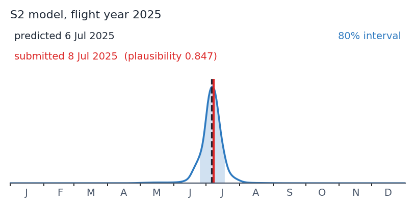

# AerialStamp

When was this aerial orthophoto taken? AerialStamp estimates the acquisition date of
an RGB drone or airborne orthophoto as a **calibrated probability for every day of
the flight year**, from

- the orthophoto itself (16 random 10 cm patches embedded with a frozen DINOv2 ViT-B/14),
- its location and the flight year, and
- the weekly Sentinel-2 time series of the site, downloaded automatically with
  [sentle](https://github.com/cmosig/sentle), including how well the orthophoto matches the
  Sentinel-2 image of each week.

It is the model of the paper *AerialStamp: estimating the acquisition date of aerial
orthophotos from the image and its Sentinel-2 time series* (Mosig et al., TODO), trained
on 6,273 dated, publicly available (CC BY) orthophotos from [deadtrees.earth](https://deadtrees.earth), where it runs on
every upload. If you just want your orthophoto dated, you can also upload it to
deadtrees.earth.

## Install

```bash
pip install git+https://github.com/cmosig/aerialstamp   # Python >= 3.12 (required by sentle)
```

A GPU is optional. The Sentinel-2 download (Microsoft Planetary Computer, no account
needed) takes a few minutes per orthophoto and is cached; the image-only model needs about
10 s on a CPU.

## Quick start

Estimate the date of a flight in 2023:

```bash
aerialstamp estimate ortho.tif --year 2023 --plot ortho_date.png --out ortho_date.json
```

Check a submitted date:

```bash
aerialstamp check ortho.tif --date 2023-06-15
```

For a flight over the Leipzig floodplain forest submitted as 8 July 2025 (from `docs/validation.md`):

```text
{
 "model": "S2 model",
 "predicted_date": "2025-07-06",
 "n_modes": 1,
 "reliable_proposal": true,
 "80% interval": {"width_days": 23.0,
                  "periods": [{"start": "2025-06-25", "end": "2025-07-17", "days": 23, "probability": 0.8027}]},
 "check": {"submitted_date": "2025-07-08", "plausibility": 0.84719, "days_from_predicted": 1.5, "flagged": false},
 "sentinel2": {"weeks_in_window": 62, "weeks_with_match_features": 42, "weeks_mostly_clear": 40, ...}
}
```



From Python:

```python
from aerialstamp import date_orthophoto

res = date_orthophoto("ortho.tif", year=2023, aoi="aoi.gpkg", device="cuda")
res["predicted_date"], res["intervals"]["80%"], res["daily_probabilities"]
```

Useful options (`aerialstamp estimate -h`):

| option | meaning |
|---|---|
| `--aoi aoi.gpkg` | area of interest (any vector format): the part of the orthophoto without reconstruction artefacts. Patches and Sentinel-2 pixels are taken from inside it. Default: all valid orthophoto pixels |
| `--mode auto\|s2\|image` | which model, see below (default `auto`) |
| `--cube cube.zarr` | an existing sentle cube of the site (7-day composites, 10 m) instead of a download |
| `--no-download` | never download; `auto` then falls back to the image-only model |
| `--cache-dir DIR` | where downloaded cubes are kept (default `.aerialstamp/` next to the orthophoto) |
| `--device cuda` | GPU for DINOv2, the model and the sentle cloud classifier |
| `--seed N` | seed of the random patch positions |

## Modes

| mode | uses | when |
|---|---|---|
| **S2 model** | orthophoto patches, site facts, and one token per Sentinel-2 week of the flight year ±35 days with band means, indices, clear-sky share and 12 orthophoto-to-Sentinel-2 match features | default whenever Sentinel-2 weeks with match features exist |
| **image-only model** | orthophoto patches and site facts only | `--mode image`, no network access, or no usable Sentinel-2 data (`auto` falls back) |

Accuracy in spatial block cross-validation on 6,225 publicly available (CC BY) orthophotos worldwide (paper, Table 3):

| | median error | mean error | within ±30 days | 80 % interval contains the date | mean width of the 80 % interval |
|---|---|---|---|---|---|
| S2 model | 18.5 d | 30.3 d | 66 % | 80 % | 96 d |
| image-only model | 25.5 d | 38.1 d | 56 % | 82 % | 123 d |

Sentinel-2 matters most in the tropics (median error 33.5 → 21.5 days) and less in temperate
forests (21.0 → 15.5 days).

## Output

- `predicted_date`: the circular median of the distribution (minimises the expected absolute error).
- `intervals`: 50, 80 and 95 % prediction intervals, i.e. the most probable days holding that
  probability; with several plausible seasons they consist of several periods.
- `daily_probabilities`: the calibrated probability of every day of the flight year.
- `reliable_proposal`: the distribution has one mode and its 80 % interval spans at most 90 days.
- with `check`: `plausibility` π, the total probability of all days the model finds at most as
  likely as the submitted day (like a p-value: for correct dates, π < 0.01 happens for 1 % of
  orthophotos), and `flagged` (π < 0.01, at least 60 days from the predicted date, one mode) —
  the experimental rule of deadtrees.earth for sending a date to manual review.
- `provenance`: model, calibration, Sentinel-2 weeks used and their clear-sky share, cube path.

## Limitations

- The model dates the day **within the given year**; a wrong year degrades the estimate to about
  the level of the image-only model.
- Sentinel-2 data start in mid-2015, so the S2 model needs flights from 2016 on. Very recent
  flights may lack Sentinel-2 weeks after the flight; the model was trained with randomly
  truncated series to cope with this.
- Evergreen tropical forests, sparsely vegetated urban areas and dryland stands that do not
  change through a long dry season give broad or bimodal distributions. Use the intervals, not
  only the predicted date.
- Trained on RGB drone and airborne orthophotos from deadtrees.earth with centimetre resolution
  (median 2.8 cm); much coarser imagery is outside the training distribution.

## Citation

```bibtex
@article{mosig_aerialstamp,
  title   = {AerialStamp: estimating the acquisition date of aerial orthophotos
             from the image and its Sentinel-2 time series},
  author  = {Mosig, Clemens and others},
  journal = {ISPRS Open Journal of Photogrammetry and Remote Sensing},
  year    = {TODO},
  doi     = {TODO}
}
```

## License

Code and model weights are licensed under
[CC BY 4.0](https://creativecommons.org/licenses/by/4.0/) (see `LICENSE`).

## How the package was built

The weights in `aerialstamp/weights/` are the paper's final recipe refit on all 6,273 labelled, publicly available (CC BY)
orthophotos with a Sentinel-2 series (five seeds per model); the calibration (temperature
T = 2.0 for the S2 model; T = 1.7 and a 10-day smoothing for the image-only model) comes from
the paper's cross-validation. `aerialstamp/weights/manifest.json` lists the recipe and the
cross-validated metrics. `docs/validation.md` compares this package with the research pipeline.
The data, the evaluation protocol and the training code of the paper are in the
[AerialStamp benchmark](https://github.com/cmosig/aerialstamp-benchmark).
